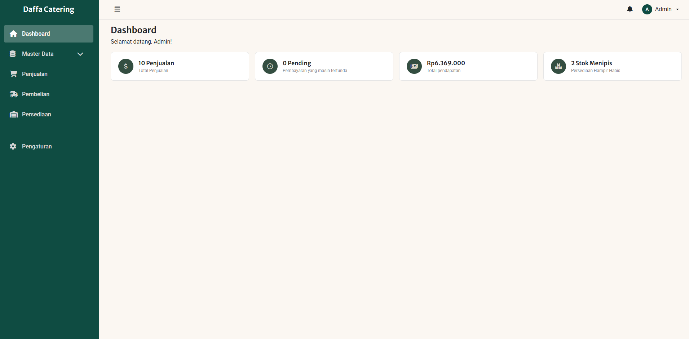
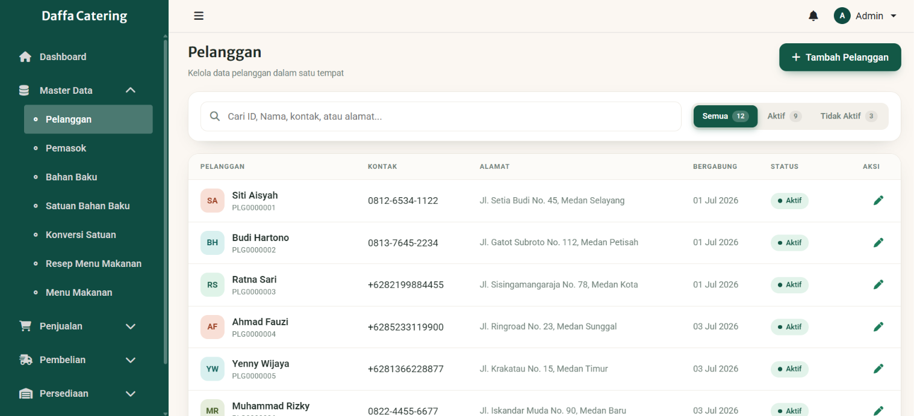
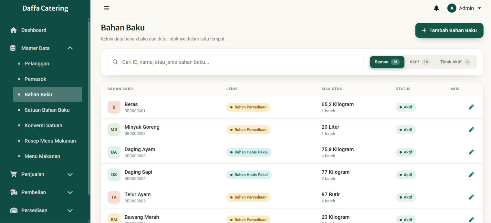
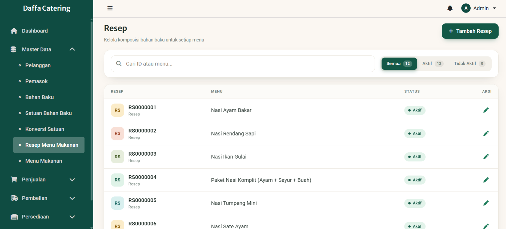
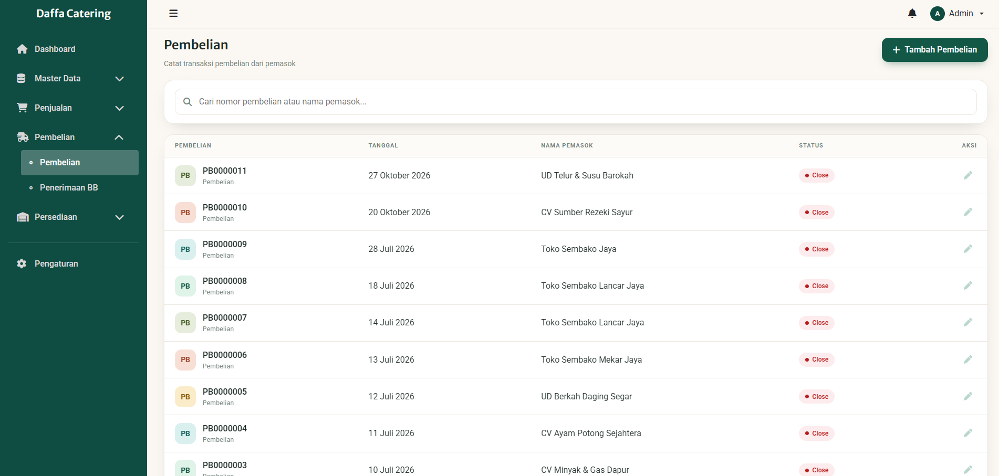
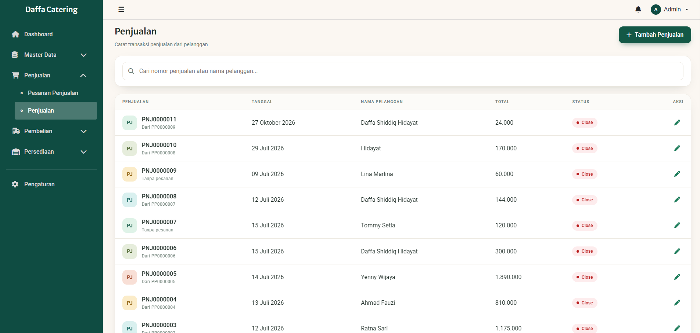
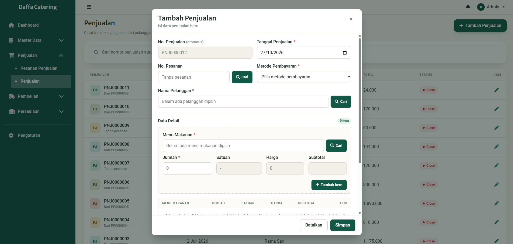
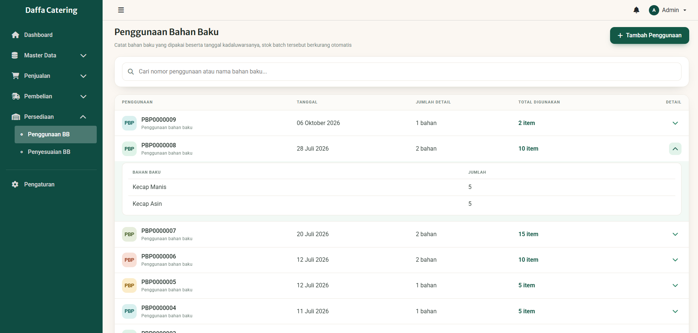
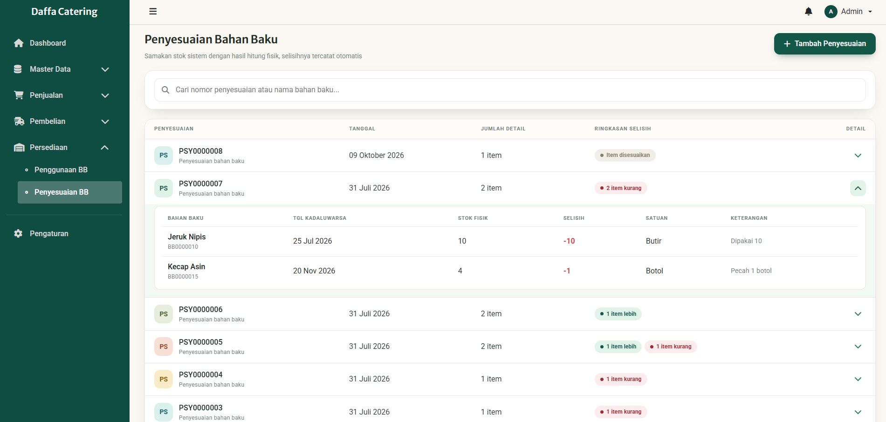
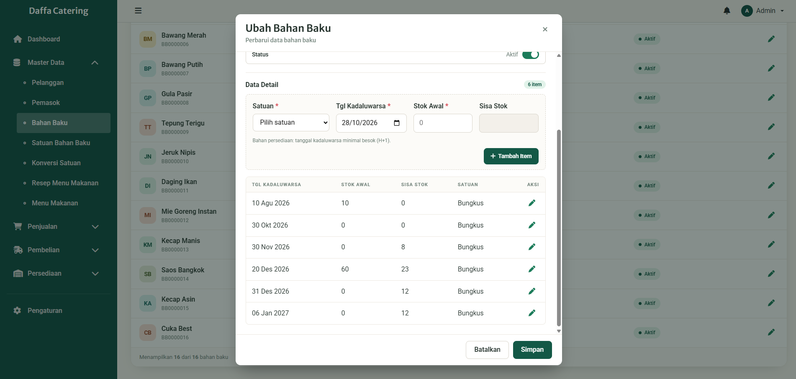

# DaffaCatering


A catering business management system rebuilt from a legacy desktop application (WinForms / .NET Framework) into a modern web architecture: an **ASP.NET Core Web API** backend with a **Blazor** frontend.

Originally developed as my Information Systems thesis project, this is an advanced iteration that separates business logic from the UI, so the same API can serve web, mobile, or desktop clients.

> **Status:** the core flow is complete end to end, from buying raw materials to selling menu items, in the web app. Remaining work: deployment and further polish. See the [Roadmap](#roadmap).

## Screenshots

| Dashboard | Customers |
|---|---|
|  |  |

| Raw Materials | Recipes |
|---|---|
|  |  |

| Purchasing | Sales |
|---|---|
|  |  |

| New Sale | Stock Usage |
|---|---|
|  |  |

| Stock Adjustment | Stock Report |
|---|---|
|  |  |

## Features

### Backend (ASP.NET Core Web API)
- RESTful CRUD endpoints for master data and transactions
- JWT authentication with BCrypt password hashing; users log in with a username
- Role-based authorization with 4 roles: `Admin`, `Penjualan` (Sales), `Pembelian` (Purchasing), `Persediaan` (Inventory)
- Business flow: purchase → goods receipt → stock usage / adjustment → recipe → order → sale
- Batch-based inventory using **FEFO** (First Expired, First Out), with automatic stock deduction when a sale consumes recipe ingredients
- Recipes modeled as a bill of materials (BOM), with unit conversion between raw material units
- Report endpoints for sales, purchasing, inventory (stock cards), menu items, raw materials, customers, and suppliers
- Header-detail transaction design across 21 tables, organized by schema (`BahanBaku`, `Pembelian`, `Resep`, `Penjualan`)
- OpenAPI document (served in Development)

### Frontend (Blazor)
- Login, with menus and pages restricted by role
- Role-aware dashboard: sales summary, pending orders, purchases not yet received, low stock, and batches nearing expiry
- Notification bell with per-role alerts (orders due by pickup date, unreceived purchases, low stock, expiring batches)
- 13 master data and transaction pages: Customers, Suppliers, Raw Materials, Raw Material Units, Unit Conversions, Recipes, Menu Items, Sales Orders, Sales, Purchases, Goods Receipts, Stock Usage, Stock Adjustments
- 7 reports: Sales, Purchasing, Inventory (stock, expiry, usage, adjustments), Menu Items, Raw Materials, Customers, Suppliers
- Settings page (Admin only) for user accounts
- Search, status filters (All / Active / Inactive), and auto-generated IDs (e.g. `PLG0000001`)
- Master data is never hard-deleted; records are set to Inactive to preserve transaction history

## Tech Stack

| Layer | Technology |
|---|---|
| Language | C# |
| Backend | ASP.NET Core Web API (.NET 10) |
| ORM | Entity Framework Core (Database First) |
| Database | SQL Server |
| Frontend | Blazor |
| Auth | JWT Bearer, BCrypt |
| Testing | xUnit, ASP.NET Core integration tests, GitHub Actions |
| API Docs | OpenAPI |

## Architecture

```
DaffaCatering.Blazor  ──HTTP/JSON──►  DaffaCatering.API  ──EF Core──►  SQL Server
   (UI only)                          (business logic,                (DaffaCateringDB)
                                       auth, data access)

DaffaCatering.Tests   ──in-memory HTTP──►  DaffaCatering.API  ──►  temporary test database
```

All business logic and data access live in the API. The Blazor project only renders the UI and consumes the API over HTTP.

## Getting Started

### Prerequisites
- [.NET 10 SDK](https://dotnet.microsoft.com/download)
- SQL Server (LocalDB, Express, or full) and SQL Server Management Studio
- Visual Studio 2022+ or the `dotnet` CLI

### 1. Create the database
In SQL Server Management Studio, create an empty database named `DaffaCateringDB`, then open `database/DaffaCateringDB.sql` and run it. It creates the tables and inserts sample (dummy) data.

### 2. Configure the connection string
The default in `DaffaCatering.API/appsettings.json` uses Windows Authentication on `localhost`:

```
Server=localhost;Database=DaffaCateringDB;Trusted_Connection=True;TrustServerCertificate=True;
```

Change it if your SQL Server instance is different.

### 3. Set the JWT signing key
The key is intentionally **not** stored in the repository. Set it with .NET User Secrets (never commit real values):

```bash
cd DaffaCatering.API
dotnet user-secrets init
dotnet user-secrets set "Jwt:Key" "<random-string-of-at-least-32-characters>"
```

### 4. Run the API
```bash
cd DaffaCatering.API
dotnet run
```
Open the HTTPS address shown in the console. In Development, the OpenAPI document is available at `/openapi/v1.json`.

### 5. Run the Blazor frontend
Make sure `ApiBaseUrl` in `DaffaCatering.Blazor/appsettings.json` matches the API's HTTPS address, then:

```bash
cd DaffaCatering.Blazor
dotnet run
```

### Demo accounts
| Username | Password | Role |
|---|---|---|
| `Admin` | `<demo-password>` | Admin |
| `Penjualan` | `<demo-password>` | Sales |
| `Pembelian` | `<demo-password>` | Purchasing |
| `Persediaan` | `<demo-password>` | Inventory |

> Sample data and demo credentials are for local development only.

## Testing

The API has **102 automated integration tests** (xUnit) that run the real API in memory against a real SQL Server database. Each test class creates its own temporary database and deletes it afterwards, so your `DaffaCateringDB` is never touched.

What is covered:
- **Role-based authorization:** every role against every protected endpoint, requests without a token, and write operations that a role must not be allowed to perform
- **Login:** valid login, wrong password, unknown user, and inactive account
- **Input validation:** required fields, password length, duplicate usernames, and invalid references
- **Stock flow:** purchase totals, receiving per batch, usage from a chosen batch, and rejection of insufficient or expired stock

Run them (requires a local SQL Server with Windows Authentication):

```bash
dotnet test DaffaCatering.Tests
```

To use a different SQL Server, set the `TEST_DB_SERVER_CONNECTION` environment variable to a connection string without a database name. The tests also run automatically on every push through GitHub Actions, using a SQL Server container.

## Roadmap
- [x] Backend: master data, purchasing, receiving, usage/adjustment, recipes, orders, sales
- [x] JWT authentication and role-based authorization (API and UI)
- [x] Blazor: login, dashboard, notifications, master data pages
- [x] Blazor: Sales, Purchasing, and Inventory transaction pages
- [x] Operational reports
- [x] Automated tests (xUnit) and continuous integration
- [ ] Unit tests for Blazor components
- [ ] Online deployment

## Author
**Daffa Shiddiq Hidayat**, Information Systems graduate.
Built as a personal portfolio project, based on the concept of my thesis project.

## License
Released under the [MIT License](LICENSE).
